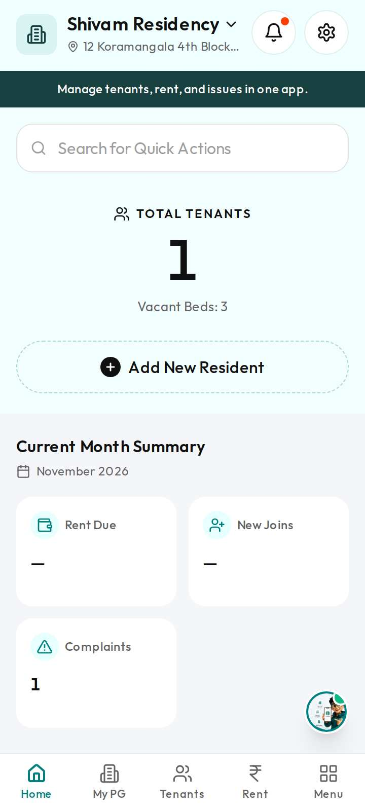
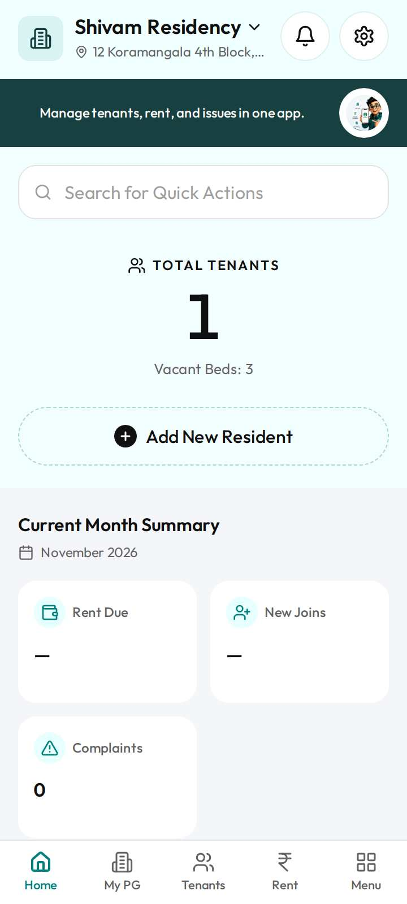
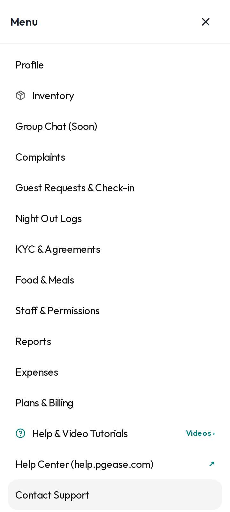
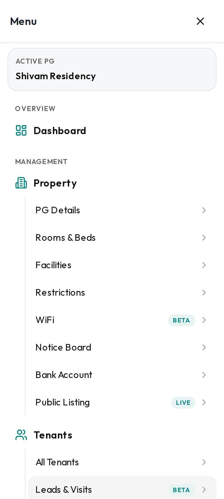
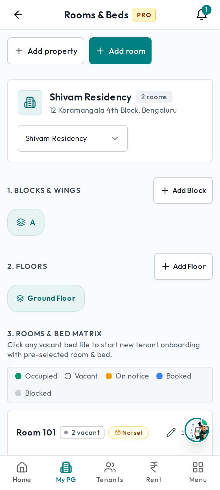
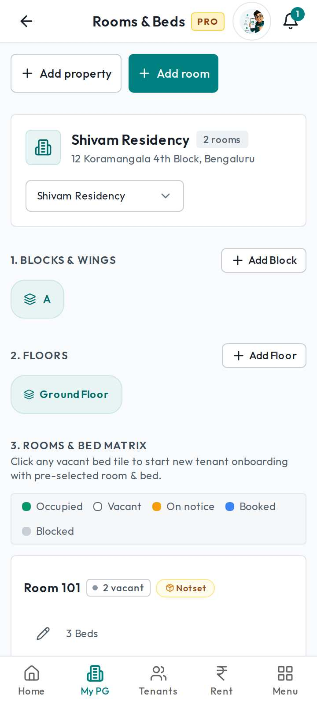
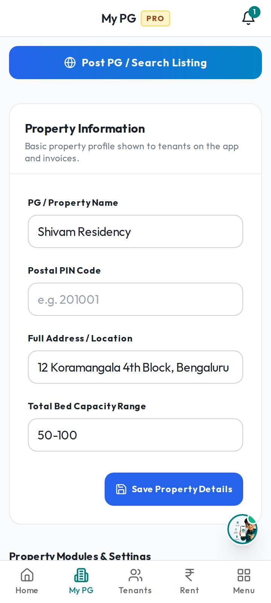
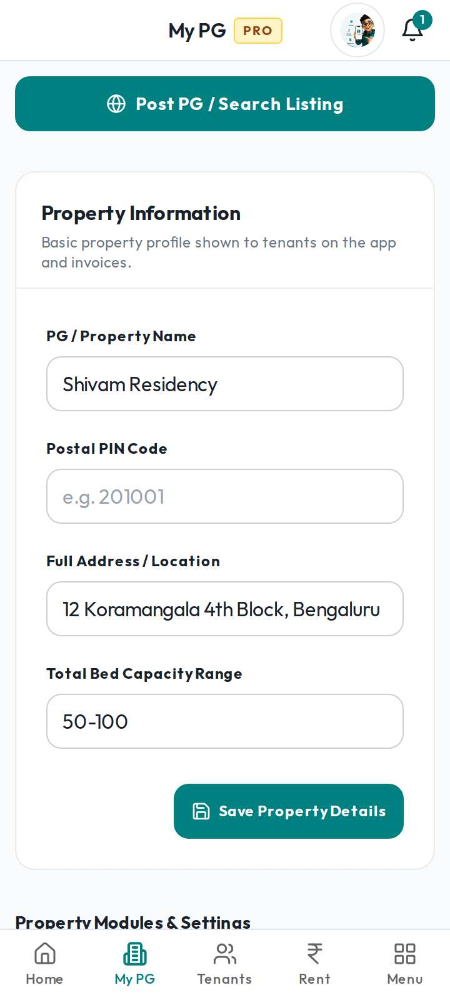
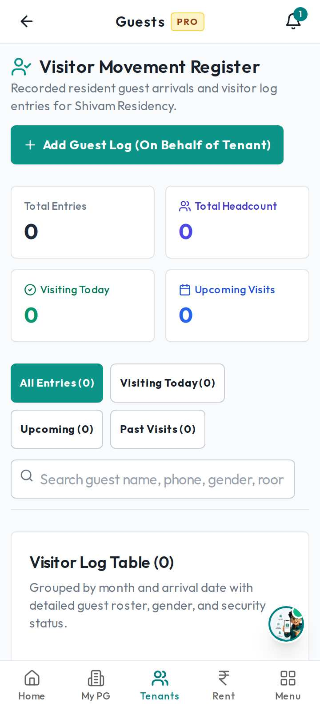
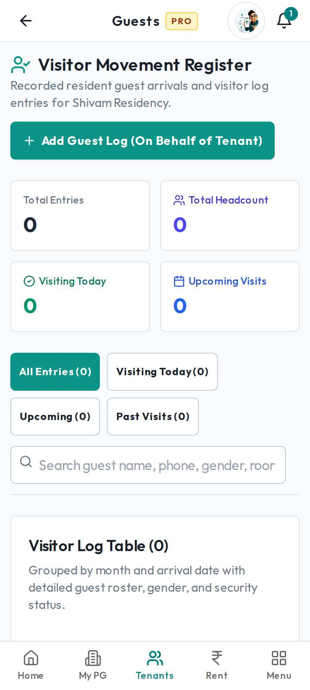

# PG Ease Owner — mobile audit

Audited in Chromium at **360×800** and **412×915** (touch, Android UA) against the local app. Authenticated screens use a local JWT and mocked API responses. No production data was created or changed.

Screenshots:

- Before: `docs/mobile-audit/before/`
- After: `docs/mobile-audit/after/`

Files are named `{viewport}-{slug}.jpg` (example `360x800-tenants.jpg`). The same slug exists at both widths. Page `scrollWidth` matched the viewport on every route before and after (no horizontal page scroll). A few elements sit off-canvas on purpose: the closed phone drawer, and decorative login circles.

## What was wrong

The desktop header (and its sidebar toggle) is `hidden` below 768px. The only phone navigation was a flat Menu list that skipped most sidebar children. A floating Ease Buddy button sat on top of search fields, export buttons, room actions and the add-tenant bar. Primary actions on My PG used blue instead of teal `#008080`. There was no web app manifest. Dialogs were centered desktop modals. Wide tables used `display: block`, which breaks table layout. File pickers used `display: none`, which Android WebViews often refuse to open. `upi://` strings existed only inside QR images, not as normal links.

## Routes, menus and findings

Status is **Fixed** when the phone layout was updated in this change. Logged-in screens still need a real owner session to show live data; the shots below are the mocked shell.

| Screen | Route | What was wrong on a phone | Status |
| --- | --- | --- | --- |
| Login / sign up | `/login`, `/signup` | Splash and sheet already fit. Decorative circles extend past the edge but do not scroll the page. Inputs are 16px. | Fixed (safe area + manifest; layout kept) |
| Home | `/dashboard` | Buddy covered the summary cards. Property switcher lived only here, so other screens could not switch PG. | Fixed |
| My PG | `/my-pgs` | Blue primary buttons. WiFi and Notice Board were not in the module grid. Section title sat on the tab bar until you scrolled. | Fixed |
| Rooms & beds | `/my-pgs/structure` | Room actions and bed count ran under the buddy. Edit control was a 24px target. | Fixed |
| Facilities | `/my-pgs/amenities` | Same shell: buddy overlap, no way back to this screen from Menu. | Fixed |
| Restrictions | `/my-pgs/restrictions` | Same. | Fixed |
| WiFi | `/my-pgs/wifi` | Search field ran under the buddy. Missing from Menu. | Fixed |
| Notice board | `/my-pgs/notices` | Missing from Menu and from the My PG module grid. | Fixed |
| Bank & UPI | `/my-pgs/bank` | UPI intent was QR-only. | Fixed |
| Public listing | `/post-pg` | Photo file input was `display: none`. | Fixed |
| Tenants | `/tenants` | Card list was already good. Add button collided with the buddy. | Fixed |
| Add tenant | `/tenants/add` | Sticky Cancel / Continue was partly covered. Camera control was 24px and `display: none`. | Fixed |
| Tenant detail | `/tenants/:id` | Not shot with a stable id in the mock. Photo input was `display: none`. Wide tabs already wrap. | Fixed (input + shared sheet/table rules) |
| Leads | `/leads` | Top bar said “Tenants”. Empty title sat under the tab bar. Missing from Menu. | Fixed |
| KYC | `/tenants/kyc` | Tab row ran into the buddy. Missing as a labelled destination from Home. | Fixed |
| Notice period | `/tenants/notice-period` | Missing from Menu. | Fixed |
| Guests | `/tenants/guests` | Search placeholder and table card ran under the buddy. Wide guest table could not scroll as a table (`display: block`). | Fixed |
| Rent | `/rent-payments` | First tenant card was clipped by the tab bar. History and dues were not in Menu. | Fixed |
| Payment history | `/rent-payments/history` | Same shell. Top bar said only “Rent”. | Fixed |
| Dues | `/rent-payments/dues` | Same. | Fixed |
| Expenses | `/expenses` | Search sat under the buddy. | Fixed |
| Complaints | `/complaints` | Reachable, but easy to miss among a flat list. | Fixed |
| Food | `/food` | Same. | Fixed |
| Night out | `/nightout` | Same. | Fixed |
| Group chat | `/group-chat` | Marked Soon. Panel layout unchanged. | Fixed (listed in Menu) |
| Staff | `/team` | Owner-only. Reachable. | Fixed |
| Permissions | `/team/permissions-matrix` | Top bar said “Staff”. Sub-item missing from Menu. | Fixed |
| Reports | `/reports` | Export button sat under the buddy. | Fixed |
| Settings | `/settings` | Upload photo sat under the buddy. File input was `display: none`. | Fixed |
| Plans | `/plans` | In the flat menu, easy to scroll past. | Fixed |
| Refer & earn | `/referrals` | Missing from the phone menu. | Fixed |
| Activity logs | `/activity-logs` | Empty state was fine. Missing from the phone menu. | Fixed |
| Notifications | `/notifications` | Bell only. Not in Menu. | Fixed |
| Support | `/support` | Last item, Logout easy to miss below the fold. | Fixed |
| Inventory | `/inventory` | In the old menu, but not grouped. | Fixed |
| Payment KYC | `/settings/payment-kyc` | Long gateway forms use the shared sheet and 16px inputs. | Fixed |
| Privacy, terms, contact | `/privacy-policy`, `/terms-and-conditions`, `/contact-us` | Readable. Linked from login. | Fixed |
| Menu | bottom nav | Flat list. No Rooms, Facilities, Restrictions, WiFi, Notices, Bank, Leads, Notice period, Payment history, Dues, Permissions, Refer & earn, Activity logs. No PG switcher. Android back did not close it. | Fixed |
| Dialogs / confirmations | shared | Centered, could sit under the keyboard or past the safe area. Back did not close them. | Fixed |
| Tables | shared `Table` | `display: block` on phones broke columns. Wide tables could not scroll inside the card. | Fixed |
| App shell | `index.html` | `viewport-fit=cover` was already set. No manifest, no standalone display, no apple web-app title. | Fixed |

### Side by side (360×800)

Home — buddy no longer covers the summary:

Menu — grouped property and tenant children:

Rooms — bed count no longer hidden behind the assistant:

My PG — teal actions:

Guests — search and table card clear of the assistant:

The same pairs exist for every slug at 360×800 and 412×915 under `docs/mobile-audit/`.

## Fixes

- Phone menu uses the same tree as the desktop sidebar (`src/lib/ownerNav.ts`), with sections and every child visible. Extra phone links: Inventory, Notifications, Contact Support, Help videos, Logout. Active PG can be switched from the menu.
- Ease Buddy’s floating button is desktop-only. On a phone it opens from the top bar (and from the home banner) and the chat is full screen. Android back closes the menu, dialogs, alert dialogs and the chat.
- Dialogs and alert dialogs become bottom sheets under 768px, with safe-area padding and a 44px close control. Desktop dialogs stay centered.
- Tables keep table layout and scroll inside their card.
- Inputs stay 16px so WebViews do not zoom. Icon buttons keep their size and grow a hit area. Text buttons stay at least 44px.
- Main content keeps `env(safe-area-inset-*)` and extra space above the tab bar.
- `public/manifest.webmanifest` is standalone, theme `#008080`, linked from `index.html`, with the apple web-app meta tags.
- Photo inputs are no longer `display: none`. The tenant selfie keeps `capture="user"`.
- “Scan & Pay Rent” and “Scan with GPay / PhonePe / Paytm to Pay” are normal `<a href="upi://…">` links.
- My PG primary buttons use `#008080`. WiFi and Notice Board are on the module grid.

Wording, API calls and business rules are unchanged.

## Checks

- `npm run build` succeeds.
- `npx tsc -p tsconfig.app.json --noEmit` succeeds.
- `npm test` — 31 tests passed.
- `npm run lint` still reports the existing project-wide issues (hundreds of `no-explicit-any` findings). Files added for this work lint clean.

## Needs the founder

- A staging owner login, if you want after-shots of live tenant, rent and KYC rows. These screenshots are mocked and do not touch production.
- The manifest icons reuse `/favicon.png`. A 192 and a 512 artwork would look sharper on the Android home screen.
- Desktop sidebar is unchanged except two extra cards on My PG (WiFi, Notice Board) that were already in the sidebar.
